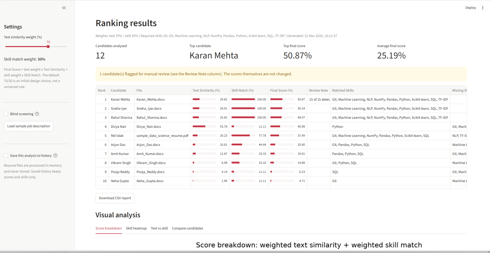

# AI-Based Resume Screening and Candidate Ranking System

  A Streamlit web app that screens many resumes (PDF and DOCX) against a job description and ranks the candidates using NLP and machine learning techniques (TF-IDF and cosine similarity), with explainable scores.

> **Decision-support tool.** It helps a recruiter shortlist candidates. It does not hire or reject anyone automatically, and the final decision always stays with a human.

**Source code:** https://github.com/mdistak/ai-resume-screening-system

**Live app:** https://ai-resume-screening-system-ia.streamlit.app/

[](https://ai-resume-screening-system-ia.streamlit.app/)

## Features

- Upload multiple PDF and DOCX resumes (up to 50 files, 5 MB each)
- Text extraction with pdfplumber and python-docx; email, phone and name detection
- Text preprocessing: cleaning, tokenization, stop-word removal, lemmatization (NLTK)
- Skill extraction from an editable skill database (70 skills with aliases)
- TF-IDF and cosine similarity between each resume and the job description
- Skill match percentage for the required skills (editable by the recruiter)
- Combined score with adjustable weights (default 70% text, 30% skills)
- Ranking dashboard with matched and missing skills, charts and candidate comparison
- "Why this score": the terms that create each text similarity
- Review flag for resumes that list many skills but never describe any work
- Blind screening mode: hides names and contact details before scoring
- CSV report download and optional SQLite history (scores only, no resume text)

## How the score works

```
Text Similarity (%)  = cosine similarity of TF-IDF vectors x 100
                       cos(A, B) = (A . B) / (||A|| x ||B||)
Skill Match (%)      = matched required skills / total required skills x 100
Final Score          = 0.70 x Text Similarity + 0.30 x Skill Match
```

The 70/30 weighting is an initial design choice, not a universal rule. It was tested with six weight pairs (see Evaluation). Both component scores are shown separately so every result can be explained.

## Evaluation (honest summary)

- Tested on 12 synthetic resumes created for this project and labelled by the author for a Data Scientist job description.
- Precision@5 was 0.8 for every tested weight pair (100/0 to 0/100), so this small sample cannot tell the weights apart.
- The one error in the top 5 at every weight was a resume that only lists keywords. The review flag marks such resumes for manual review; it does not change the score.
- These are indicative results on a small synthetic sample, **not a general accuracy**. A similarity score is not a prediction probability.

## Limitations

- Skills are matched from a dictionary, so unknown skills and synonyms are missed
- TF-IDF compares words, not meaning, and its values depend on the batch of resumes
- Keyword-heavy resumes can score high; the review flag is a heuristic and is not validated
- Scanned (image only) PDFs are not supported because there is no OCR
- Blind screening hides name and contact details only, not other proxies such as college or city
- Saved history may be reset on free cloud hosting

## Installation

Tested with Python 3.12.

```bash
git clone https://github.com/mdistak/ai-resume-screening-system.git
cd ai-resume-screening-system
python -m venv venv
venv\Scripts\activate          # Windows (macOS/Linux: source venv/bin/activate)
pip install -r requirements.txt
streamlit run app/streamlit_app.py
```

The required NLTK data is downloaded automatically on the first run.

## Tests

```bash
python scripts/run_all_tests.py
```

Runs 9 test scripts (over 150 automated checks) and writes the full log to `docs/test_log.txt`.

## Project structure

```
app/streamlit_app.py     Streamlit dashboard
src/parser.py            PDF/DOCX text extraction, email, phone, name
src/preprocessing.py     Cleaning, tokenization, stop words, lemmatization
src/skills.py            Skill extraction, JD skills, skill evidence
src/matcher.py           TF-IDF, cosine similarity, scoring, ranking, explanation
src/evaluation.py        Weight sensitivity, precision, recall, F1
src/visualization.py     Matplotlib and Seaborn charts
src/database.py          SQLite history
src/anonymize.py         Blind screening
data/skills_db.json      Skill knowledge base
data/sample_jd/          Sample job description
data/sample_resumes/     Sample resumes (synthetic, fictional people)
data/evaluation/         Human labels used for evaluation
tests/                   Test scripts
scripts/                 Test runner and requirements pinning
screenshots/             Dashboard and chart screenshots
docs/test_log.txt        Latest full test log
```

## Privacy

No real resumes are included; sample resumes are synthetic. In the app, resume files are processed in memory and are not stored. The optional history keeps only candidate names, scores and skills, never resume text, emails or phone numbers.

## Author

[Md Istak,Md Aakib], B.Tech CSE, [Amritsar group of colleges]